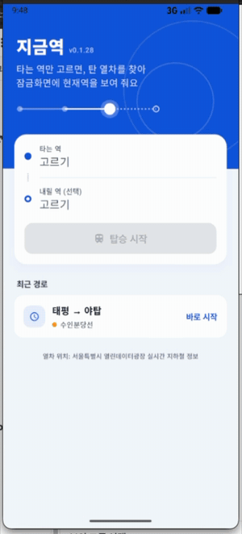
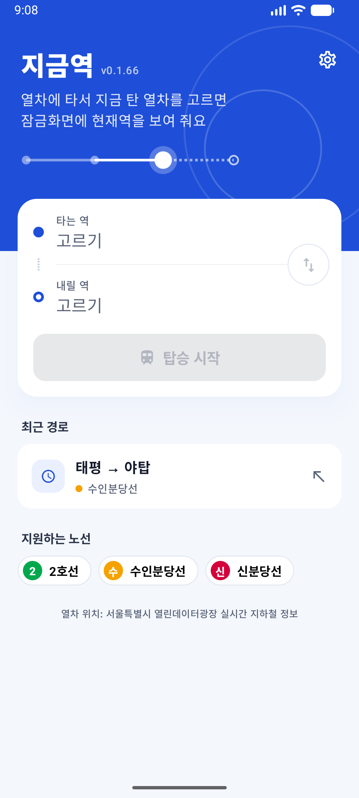
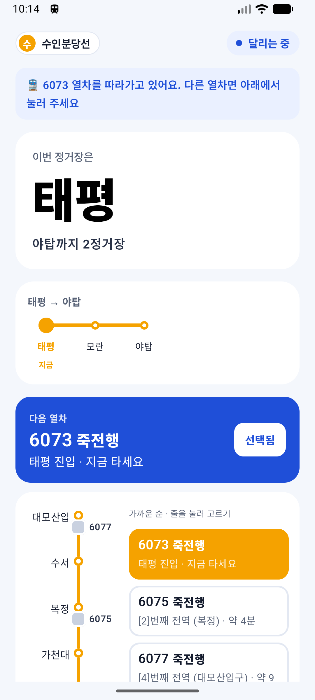
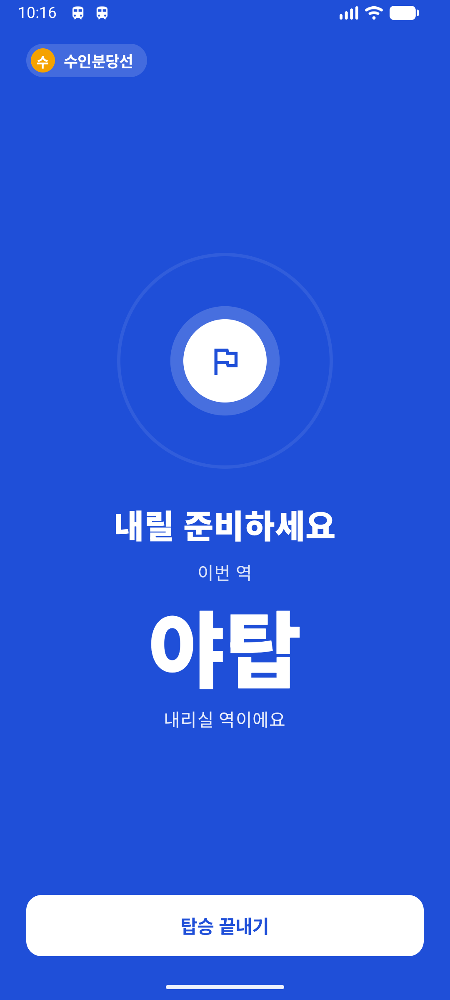
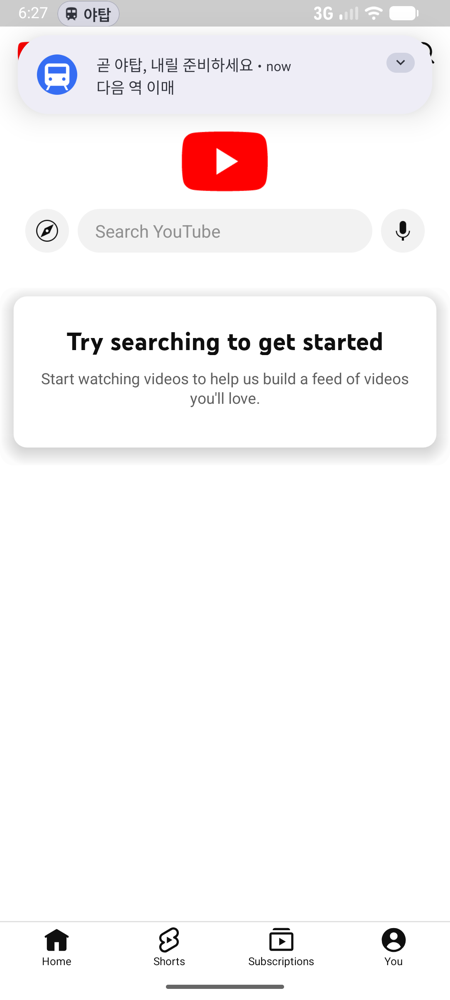
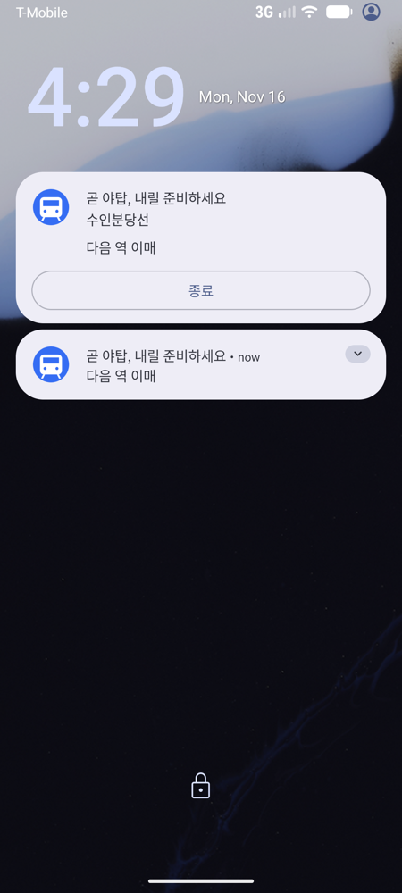

# NowStation Android (지금역)

지하철에서 **지금 무슨 역인지**를 잠금화면과 상태 표시줄에 보여 주는 앱입니다.
타는 역과 내릴 역을 고르고 시작하면 끝입니다. 열차를 놓쳐도, 열차가 역 사이에 멈춰도, 갈아타도 실제 운행 그대로 따라가고, 내릴 역 직전에 다른 앱 위로 알려 줍니다.

탄 열차를 찾는 판단은 서버가 합니다 → [NowStation-Server](https://github.com/sinadsl1457/NowStation-Server)(전체 구조도와 판단 원리).
iOS 버전 → [NowStation-iOS](https://github.com/sinadsl1457/NowStation-iOS)(같은 화면·판단 규칙, 개인 테스트용).
앱은 **폰이 출발·정차한 순간을 가속도 센서로 잡아 보내고**, 결과를 **앱을 보지 않아도** 알림으로 보여 줍니다.

<p align="center"></p>
<p align="center"><sub>태평 → 강남(선릉에서 2호선 환승). 퇴근 시간 <b>합성</b> 열차 데이터(<code>make_rush_hour.py</code>)를 재생 서버로 흘려 에뮬레이터에서 찍은 장면(29분 → 43초 요약, <a href="docs/demo/nowstation-demo.mp4">mp4</a>)</sub></p>

| 홈 | 다가오는 열차 고르기 | 내릴 역 직전 | 다른 화면 위로 | 잠긴 폰 |
|---|---|---|---|---|
|  |  |  |  |  |

## 기술적으로 신경 쓴 부분

| 문제 | 해결 |
|---|---|
| 가속도 센서는 속도가 **바뀌는 순간**만 느껴서, 일정하게 달리는 열차와 멈춘 열차를 구분하지 못함 | 상태를 재지 않고 **사건만** 잡음: 4초 넘게 이어지는 가속 = 출발, 출발과 반대 방향 감속이 끝남 = 도착. 서버가 필요한 것도 이 두 순간뿐 |
| 걷기·폰 만지기·폰 돌리기가 출발로 잡히면 엉뚱한 열차에 붙음 | 큰 흔들림이 있는 동안은 판단하지 않고, 중력 방향이 20° 넘게 바뀌면(폰을 돌림) 다시 기준을 잡음. 합성 신호 테스트로 고정(걷기 2Hz, 2초 덜컹임, 폰 눕히기) |
| 사용자는 앱을 보지 않음(YouTube, 카톡, 잠긴 폰) | 포그라운드 서비스가 5초마다 갱신, 탑승 중 CPU 깨워 두기. 알림 채널을 둘로: 진행 중(조용히 계속 바뀜) / 내릴 역(한 번, 다른 앱 위로 팝업). Android 16 **Live Update**로 상태 표시줄 칩·잠금화면 맨 위 |
| 지하철은 무음 모드가 많음 | 내릴 역 진동을 **알람 용도**로 냄(알림 용도 진동은 무음이면 꺼짐) |
| 지하에서 연결이 끊김 | 마지막 역을 그대로 두고 "연결 끊김" 표시. 못 보낸 움직임은 쌓았다가 연결되면 한꺼번에(갱신과 센서가 겹쳐도 같은 것을 두 번 보내지 않게 `Mutex`) |
| 화면이 사라져도 탑승은 계속돼야 함 | 탑승 상태를 화면 ViewModel이 아니라 `@Singleton RideTracker`가 갖고, 화면·서비스·알림이 같은 `StateFlow`를 봄 |
| 실기기 없음 | 판단 규칙은 순수 Kotlin(합성 신호 단위 테스트). 화면·알림은 서버 재생 모드 + `adb emu sensor`로 실제 녹화 시각에 맞춰 센서를 넣고, 화면 글자·시스템 알림 글자·진동 기록을 자동 대조 |

## 구조

```
app/src/main/java/com/nowstation/app/
├ MainActivity.kt          탑승 중이면 탑승 화면, 아니면 홈
├ core/                    결과·오류 타입, 네트워크(Retrofit), 테마
├ station/                 역 검색 + 홈 화면. 상태는 홈 ViewModel이 갖고 화면과 함께 사라짐
└ ride/                    진행 중인 탑승. 화면이 사라져도 계속돼서 @Singleton이 가짐
   ├ domain/RideTracker.kt   앱 전체가 같이 보는 탑승 상태, 못 보낸 움직임 쌓기
   ├ data/                   서버 탑승 API
   ├ motion/                 가속도 → 출발·도착 사건(순수 Kotlin), 기준값 MotionRules
   ├ service/                포그라운드 서비스(갱신·센서·진동·CPU 깨우기) + 알림 두 채널(Live Update·하차 팝업)
   └ ui/                     탑승 화면, 화면·알림 공용 문구(RideTexts)
```
- 의존 방향: `ui → domain ← data`. domain은 Android를 모른다(시간은 주입한 `Clock`).
- ViewModel은 Context를 모른다. 서비스 시작은 `RideServiceLauncher` 인터페이스로.

## 기술 스택

Kotlin · Jetpack Compose(Material 3) · Coroutines/Flow · Hilt · Retrofit + kotlinx.serialization · OkHttp · SensorManager · Foreground Service · NotificationCompat(Live Update) · JUnit4 + kotlinx-coroutines-test · MockWebServer

## 테스트

- 단위 테스트 55개: 움직임 판단(합성 신호), 못 보낸 움직임 쌓기·버리기, 내릴 역 알림 시점, 문구, 저장소(MockWebServer), 홈 ViewModel, 노선도·열차 바꾸기(탑승 중에만 15초마다 받기), 안내 띠 문구
- 에뮬레이터 시연(서버 `scripts/demo/run_scenario.py`): 앱 화면 / YouTube를 보는 중 / 잠긴 폰에서 각 3/3, 환승·지하 끊김 5/5

```bash
./gradlew testDebugUnitTest
```

## CI/CD (GitHub Actions → Google Play)

```
push(모든 브랜치) ─→ [CI] 단위 테스트 → 개발용 빌드 → 정식 빌드(R8) 확인          .github/workflows/android.yml

태그 v* 또는 버튼 ─→ [CD] 단위 테스트 → versionCode 자동 → 업로드 키로 서명 → 서명 확인   .github/workflows/release.yml
                       → Google Play Developer API로 테스트 트랙에 업로드(R8 mapping, 출시 노트 포함)
```

| 결정 | 이유 |
|---|---|
| **versionCode = main의 커밋 수** | Play는 같은 번호를 다시 받지 않는다. 손으로 올리다 번호가 겹쳐 거절당하던 문제를 없앰. 내 컴퓨터·GitHub 어디서 빌드해도 같은 번호 |
| 서명 값은 GitHub 비밀값에만 | 업로드 키·비밀번호는 저장소에 없다. 빌드할 때만 꺼내 쓰고, 실제 앱 서명 키는 Google이 보관(Play 앱 서명) |
| **서비스 계정은 이 앱의 출시 권한만** | 회사 개발자 계정이라 다른 앱이 있다. 계정 전체가 아니라 지금역 하나, 출시 권한만 줘서 키가 새도 다른 앱은 건드릴 수 없게 |
| 별도 Google Cloud 프로젝트 | Play API·서비스 계정을 다른 프로젝트와 섞지 않음 |
| 출시 노트 = 마지막 커밋 제목 | 테스터가 무엇이 바뀌었는지 Play에서 바로 봄 |
| R8 mapping 같이 업로드 | 줄여진 코드 이름 때문에 읽을 수 없는 비정상 종료 보고서를 Play Console에서 원래 이름으로 |
| 첫 심사 전에는 초안(draft) | Play는 첫 심사를 통과하기 전의 앱에 바로 출시하는 릴리스를 API로 만들 수 없게 한다(실제로 거절당해 선택지로 추가) |

```bash
git tag v0.1.30 && git push origin v0.1.30     # 비공개 테스트 트랙에 바로 출시
# 또는 Actions → "Android Play 배포" → Run workflow(트랙: alpha·internal·production, 상태: completed·draft)
```

## 실행

```bash
# 서버: NowStation-Server에서 ./gradlew bootRun (또는 배포 서버)
./gradlew installDebug                                   # 서버 주소: local.properties의 API_BASE_URL, 없으면 10.0.2.2:8080(에뮬레이터에서 본 내 컴퓨터)
./gradlew installDebug -PAPI_BASE_URL=http://10.0.2.2:8080/   # 잠깐 다른 서버로(시연용 재생 서버 등)
```
- 배포 서버(AWS EC2)는 https(Caddy + Let's Encrypt)입니다. 앱은 http를 내 컴퓨터(10.0.2.2·localhost)에만 허용하고(`res/xml/network_security_config.xml`), 정식(release) 빌드는 서버 주소가 https가 아니면 빌드가 멈춥니다.
- minSdk 26, targetSdk 36. Live Update는 Android 16 이상에서만 보이고, 그 아래에서는 일반 진행 중 알림입니다.

## 한계

- **움직임 판단 기준값(`MotionRules`)은 실기기로 다시 맞춰야 합니다.** 합성 신호와 에뮬레이터 주입(깨끗한 계단 모양)으로만 확인했습니다.
- 잠긴 폰에서 하차 팝업이 화면을 켜지는 않습니다(에뮬레이터 확인. 실기기는 "알림 오면 화면 켜기" 설정에 따름). 그래서 진동이 주 신호입니다. 화면을 강제로 켜는 전체 화면 알림은 Android 14부터 전화·알람 앱에만 허용돼 쓰지 않았습니다.
